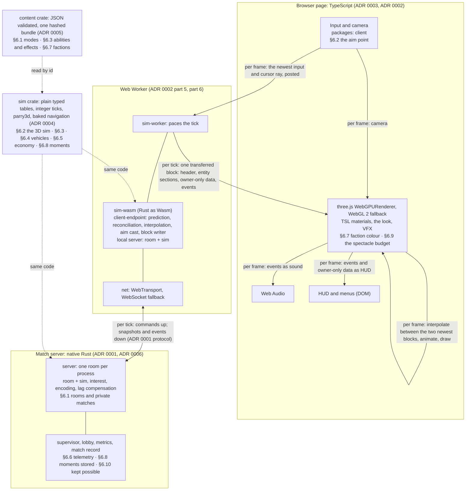

# ENGINE_OVERVIEW: the v2 engine on one page

**Status:** Proposed, with the six decision drafts · **Date:** 2026-11-01 · **Author:** engine-architect (the
synthesis) · **Signed off by Mustafa:** as the basis for the spikes (2026-11-03, SPIKE-ORDER (b)); not yet accepted.
This page joins what [ADR 0001–0006](adr/README.md) propose and decides nothing of its own; every detail links to its
draft. The spikes are in [SPIKE_PLAN](SPIKE_PLAN.md).

## The engine in one paragraph
One Rust simulation decides everything that counts. The same code runs natively in each room process on the match
server and as WebAssembly in one Web Worker in the browser, where it is the client endpoint (prediction and
reconciliation) online and in local play, and in local play also the local server, from slice 1 (SLICE-ORDER,
condition 1). The page is TypeScript on three.js `WebGPURenderer` with its WebGL 2 fallback; it draws, animates and
plays sound from one block of data per tick and never decides a hit, a death or a purchase. Content (units, vehicles,
weapons, abilities, effects, upgrade tracks, modes, maps, tuning) is JSON that one Rust content crate validates the
same way on the server, in the Worker and in the editor. The server ticks at 30 Hz (TICK-30) for up to N = 48 players
(the largest mode, 24v24: MODES-3 (a)); 60 Hz only with [the 60 Hz margin](research/GLOSSARY.md#the-60-hz-margin),
every 60 Hz research mark and the goal budget holding at the rooms per VM measured at 60 Hz, as slice 6's run on the
real sim shows; the netcode proof test's 60 Hz run is an early signal only (ADR 0001 part 2).

## The parts and the boundary

In words: the page posts its newest input to the Worker each drawn frame and receives one block per tick back; it
makes no call into Wasm and touches no network (ADR 0002 part 5). Per frame it interpolates between the two newest
blocks, animates, draws, and plays the block's events as sound and HUD feedback (ADR 0003 part 10). The Worker holds
the Rust sim as Wasm (the client endpoint is its own crate) and owns the connection (ADR 0002 parts 3 and 5). Online
it talks to the room process over WebTransport, or WebSocket when that fails (ADR 0001 part 10); in local play the
same Worker also runs the room and the sim as the local server, reached through the loopback with the same messages
(SLICE-ORDER condition 1; ADR 0002 part 6). The sim crate and the content crate sit below everything. Each part's
label names the main VISION_V2 §6 items it serves; the table below gives every draft and part.

**The Rust ↔ TypeScript boundary** (ADR 0002 part 5; interfaces I-2, I-3, I-5 in [the register](adr/README.md#codes-the-drafts-cite)):
- **Down (Worker → page):** one transferred output block per tick (B2): a header (tick, layout hash, counts), sections
  per entity kind, the local player's owner-only data (own weapon, money, upgrade tracks and offers) and an event
  section (ADR 0004 part 19's events, such as hits, deaths and kills, blasts, purchases, uplink cache events, tech
  tiers, upgrade picks and pickups, and moments; a remote entity's spatial events come in the block whose delayed time
  reaches their tick, ADR 0001 part 7); the SharedArrayBuffer ring (B3) is measured against it in the boundary spike.
  Remote entities' fields online are ADR 0001's; the layout is ADR 0002's.
- **Up (page → Worker):** the newest input once per drawn frame, with the cursor ray and view time; each tick the
  Worker fills its one network command from the newest post, aim point included (I-19; ADR 0001 part 5; ADR 0002
  part 5); a small control API (start, mode flag, content bundle).
- **Types:** generated from Rust into `packages/types`: the block layout and its hash, the protocol types, the content
  schema and types (ADR 0002 part 5; ADR 0005 CD-3). No call per entity per frame crosses the boundary.

**Dependencies point one way** (ADR 0002 part 3, each a gate check): `sim` depends on `content` only, with no
transport, no async runtime and no clock; `room` and `client-endpoint` build for Wasm and natively with no async
runtime, no transport and no clock; `protocol` uses `sim` and `content` types; `sim-wasm` holds `client-endpoint`,
`room`, `sim`, `protocol` and `content`, never `navbake` or `server`; `server` adds the transport and the runtime; the
`supervisor` links no sim code; `client` never reaches `editor`. Among the tools, `devtools` may depend on any
workspace crate and `navbake` on `sim` and `content`; the editor uses `client` code and the `navbake` and `sim` Wasm;
nothing imports `legacy/` or `spikes/`. Each crate enters with the first slice that needs it.

## The data flow
**Per tick (30 Hz; ADR 0004 parts 4–5, ADR 0001 parts 2–9):**
1. Inputs: each client sends one command per tick (movement, buttons, aim point); bots drive the same input path
   (ADR 0001 part 11; ADR 0004 part 15).
2. Simulation: the authority (the room on the server; the Worker in local play) runs the fixed phases on integer ticks
   from validated content: movement and collision queries, weapons and the ability and effect step, economy and
   objectives, the player records, events and moments (ADR 0004 parts 4, 10–19). Randomness comes from seeded
   streams; the authority-only stream holds the weapon spread (SEC-SPREAD (a); ADR 0004 part 8).
3. Snapshots and events: the room encodes, per client, a delta snapshot of what that client may see, plus events with
   visibility classes (ADR 0001 parts 6 and 9); the match record collects tick-stamped events (ADR 0004 part 19;
   ADR 0006 part 12).
4. Client: the Worker predicts the local player's movement and own weapon, reconciles with each snapshot, interpolates
   remote entities and releases their spatial events on its delayed timeline; a shot is judged on the server against
   what the shooter saw, within a cap (ADR 0001 parts 4, 7, 8; the abilities' prediction waits for ABL-PREDICT).

**Per frame (the page; ADR 0003 part 10):** keep the two newest blocks; interpolate between them and animate (procedural
touches, budget LOD); draw with the look pipeline (ADR 0003 part 5); play the block's events as VFX, sound and HUD
feedback (hit feedback on confirmation, LOOP_V2 §7); post the newest input with its cursor ray and view time (ADR 0002
part 5). Presentation randomness stays on the page (ADR 0004 part 8).

**Who owns which state:** the authority owns all game state (soldiers, vehicles, projectiles, effects, money, tech,
player records with their upgrade tracks); the Worker owns predicted local state and the interpolation buffer; the page
owns only presentation state (camera, animation, VFX pools, audio voices, HUD). Production pins one content set per
match (ADR 0005 CD-7). Details: ADR 0001 "State ownership".

## Where each VISION_V2 §6 requirement lives
| §6 | Requirement | Where it lives (draft, part) |
|---|---|---|
| 1 | Modes as data: 2 or 3 teams of any size, one faction per team, rooms and private matches | ADR 0001 part 11 (rooms, private rooms, a room as a mode id plus overrides, bots fill slots); ADR 0005 CD-6 (mode files, factions as data); ADR 0006 parts 5–6 (hosting rooms, the lobby) |
| 2 | A true 3D sim: floors, interiors, ledges, sight across heights; bots between levels; aiming at height | ADR 0004 parts 10–13 (collision queries, baked navigation, floors and typed links, sight); ADR 0001 parts 5 and 9 (the aim point in the command; enclosures in interest); ADR 0002 part 5 (the aim point across the boundary); ADR 0003 part 10 (the cursor ray hits the drawn state) and part 5.i (roof fade) |
| 3 | A data-driven ability and effect system | ADR 0005 AB-1 to AB-10 (a reduced GAS subset as data, upgrades included); ADR 0004 part 16 (execution and its cost); ADR 0001 part 4 (the prediction scope) |
| 4 | Vehicles as first-class: big, multi-part, own weapons and abilities | ADR 0004 parts 10 and 14 (compound bodies, vehicles as obstacles); ADR 0001 parts 6 and 9 (parts in snapshots and interest); ADR 0003 part 6 (very large units); ADR 0005 AB-6 (leech: an effect removed when its source dies and a last-hit trigger that moves the victim's item to the source; marking: an effect that grants a tag). `[OPEN]` seats: no feature; R2-SYNC-OQ7 stays a design question |
| 5 | Economy and objectives, server-side and tunable | ADR 0004 part 17 (sim phases); ADR 0005 CD-6, CD-10 (tuning tables); ADR 0001 part 9 (visibility classes) |
| 6 | Balance telemetry | ADR 0004 part 19 (events); ADR 0001 part 11 (the room writes the record at Ended); ADR 0006 part 12 (shape, storage, analysis); ADR 0005 CD-12 (telemetry ids) and CD-8 (the content hash every match records) |
| 7 | A faction content pipeline as data | ADR 0005 CD-13 (faction variants) and AP-3 (faction colour slots); ADR 0003 part 6 (per-instance faction colour) |
| 8 | Moments recognized by the server | ADR 0004 part 19 (recognition in a sim phase); ADR 0005 CD-12 (rules as data); ADR 0006 part 12 (stored with the record). `[LATER]` kill-cams, replays, highlights: no feature; recorded matches and per-tick state hashes (ADR 0004 parts 7–9) keep them possible |
| 9 | A spectacle budget: a few very large units without dropping frames | ADR 0003 parts 3, 6, 7 (no first-sight stutter, very large units, budgets; part 7's presented-frame count reads "without dropping frames", PM-0003-44: at most 6 of 600 presented frames may miss a refresh with the very large units on screen, on the recommended desktop at High, OQ-0003-17, answered 2026-11-03); ADR 0002 part 5 (the sim off the page's thread); ADR 0004 (its share: the very large units are in the stress scene its sim is measured in, GLOSSARY §3) |
| 10 | `[LATER]` Accounts | no feature; ADR 0001 part 11 (guest identity) and ADR 0006 part 6 (the lobby's store, OQ-0006-3) keep it possible |

Features whose need lies outside §6 (LOOP_V2, EDITOR_V2, LOOK_V2, UPGRADE-SCOPE, GLOSSARY §8's foundation, VISION_V2
§3/§4) are listed one line each in [the register](adr/README.md#needs-outside-vision_v2-6).

## The drafts
| ADR | Decides | Its spikes |
|---|---|---|
| [0001](adr/0001-multiplayer-netcode.md) | authority, the tick rule, budgets, prediction, snapshots, lag compensation, interest, transport, rooms, upgrades' network side | the netcode proof test; the 60 Hz margin run (an early signal; slice 6's run on the real sim makes the call) |
| [0002](adr/0002-code-structure-build-toolchain.md) | repository, toolchains, crates and dependency rules, the boundary, the skeleton, lint, tests, CI gate v2, previews, the editor build | the Rust ↔ TypeScript boundary spike; the foundation's checks |
| [0003](adr/0003-rendering.md) | the renderer and fallback, how each LOOK_V2 item is achieved, characters and crowds, client budgets, measurement, audio, the per-frame flow | the look proof test; the render budget bench |
| [0004](adr/0004-simulation-core.md) | plain typed tables, ids, snapshots, the tick, identical results, random streams, physics, navigation, floors, sight, bots, the player record | the sim core spike (and shares in four others) |
| [0005](adr/0005-content-abilities-assets.md) | content as JSON in one crate, the bundle and its hash, the ability and effect system, upgrade tracks, the asset pipeline | the content and ability spike; the asset spike; the Feel Lab test |
| [0006](adr/0006-infrastructure-operations.md) | the client host, previews, game servers, the lobby's place, certificates, costs, logs, crash reports, telemetry, the security baseline (open) | the preview hosting check; operations marks in the netcode proof test |

## What it rests on (settled; never reopened)
The stack, MODES-3 (a), TICK-30, SLICE-ORDER and its three conditions, PREVIEW-WALL (a), SEC-SPREAD (a), ABL-PREDICT
(waits for the Feel Lab test), BASELINE-WHEN (b), UPGRADE-SCOPE (Mustafa, 2026-10-31), SPIKE-SCOPE (a), R7-MARKS (a)
and LOOK_V2 (authored glTF/GLB models allowed): their words are in `docs/STATUS.md`. The foundation, the netcode proof
test and the 60 Hz margin: [GLOSSARY §8](research/GLOSSARY.md#8-phase-1-terms-the-advisor-2026-10-31). The shared
terms (the stress scene, the test-mode list, the server tick budget and its shares, the prediction scope, the random
streams): [GLOSSARY §1–§7](research/GLOSSARY.md).

## Open, for Mustafa and the Advisor
Every decision the drafts route to them, with its open question, is in
[the register's "Decisions the drafts ask for"](adr/README.md#decisions-the-drafts-ask-for); the design questions the
research left to them are in its "Design questions" section; the loose ends are in its "Loose-ends register".
