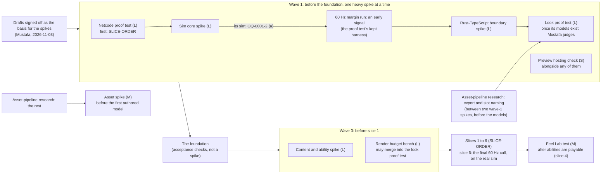

# SPIKE_PLAN: the v2 spikes

**Status:** Proposed, with the six decision drafts (`docs/adr/0001`–`0006`) · **Date:** 2026-11-01 · **Author:**
engine-architect (the synthesis, plan step 6), from test-engineer's spike entries and the drafts' "What a spike must
prove" parts · **Signed off by Mustafa:** as the basis for the spikes (2026-11-03, SPIKE-ORDER (b)); not yet accepted

This file names every spike the six drafts ask for, once; the drafts' working names point here. For each spike it says
what it proves (by ADR and decision part), which pass marks judge it (by id: the numbers live only in each draft's
"### Pass marks" table and are never restated here), who judges what, where it sits in the order, a rough size, and the
research spikes it takes in. It decides nothing new: where the drafts leave a choice open, it names the open question.

**Rules for every spike.** A spike is throwaway, lives in `spikes/`, and is exempt from the legacy hard constraints
(SPIKE-SCOPE (a)). Mustafa signed the six drafts off as the basis for the spikes on 2026-11-03 (SPIKE-ORDER (b)); each
spike is still its own change-set, plan first (CLAUDE.md, "The change-set protocol"), and wave 1 runs one heavy spike
at a time (below). Every server number is at the 30 Hz baseline (TICK-30); the 60 Hz form runs only in the 60 Hz
margin run below and in slice 6's final 60 Hz run. Where a research mark gives N = 48 and N = 54, N = 48 holds
(MODES-3 (a)).

**Sizes** (test-engineer's definitions, plan step 4): **S** about a day, **M** 2 to 4 days, **L** a week or more of
session work. A share of another spike is sized as the part it adds.

## Shared fixtures (defined once, cited by every spike)
- **The stress scene:** [GLOSSARY §3](research/GLOSSARY.md#the-stress-scene). At N = 48 (MODES-3 (a)) it is three teams
  of 16 bots in one fight, 15 big vehicles (4 of them very large units), 300 live projectiles, up to 8 active effects per
  soldier, on one DM_Tri-sized 3D greybox. Its counts stay proposals until the game-designer sets caps (R2-BUD-OQ5,
  a design question: `docs/adr/README.md`); the spikes use them as GLOSSARY §3 gives them. A server mark that includes
  the server-only share puts a snapshot-receiving client on every soldier (GLOSSARY §3).
- **The test-mode list:** [GLOSSARY §2](research/GLOSSARY.md#the-test-mode-list): 24v24 and 12v12v12; 16v16v16;
  1v1, 4v4, 2v2v2 and 6v6v6; the N = 64 run, labelled headroom.
- **Machines** (named in each draft's pass-mark key): RS, the reference server, the CCX23 (x86-64 AMD), on which every
  server row runs, and LG, the load generator, a CAX21 (Arm64) running the simulated clients, "so their build targets
  aarch64" (Mustafa's Hetzner check, 2026-11-03), both created in Falkenstein (`fsn1`) on the run day (ADR 0006,
  OQ-0006-1 and OQ-0006-2, answered by Mustafa, 2026-11-03: "both test servers will be in Falkenstein, not Nuremberg: a
  CCX23 for the game server and a CAX21 for the 48 simulated players"; [GLOSSARY: the reference
  server](research/GLOSSARY.md#the-reference-server)); a run whose bots one CAX21 cannot carry under 80 % adds as many
  CAX21s as its 5-minute calibration shows are needed, inside the cost cap Mustafa OKs for that run (LG-COUNT, the
  option he chose, 2026-11-03); MV, the metrics role: Prometheus on LG's CAX21, never on RS, inside LG's 80 % rule,
  standing in for the staging game server, and a run with more than one CAX21 says in its plan which one carries it (ADR
  0006; the advisor's reading, 2026-11-03); ML, the minimum laptop, RD, the recommended desktop, and MAC, the Mac for
  Safari, with the stable Safari on the day of the run, its version recorded (WebGPU from Safari 26.0: r3-rendering.md,
  R3-WGPU-F19, lines 171–174; WebTransport from 26.4: r2-netcode.md, R2-TRN-F7, lines 959–975). Which machines they are
  is OQ-0003-1 (ADR 0003), answered in part by Mustafa (2026-11-03): "minimum: a typical student laptop with integrated
  graphics; recommended: a desktop with a mid-range card (RTX 3060/4060 class); Mac: a MacBook Air, M1 or newer, for
  Safari. All borrowed."; still open: the actual machines, named by Mustafa before the look proof test. When each
  machine is needed, in his words (Mustafa, 2026-11-03): "For the netcode proof test's Safari leg, check whether
  GitHub's macOS runners (real Safari, free while the repository is public) have a Safari new enough for WebTransport
  and can reach the test servers. If they can, that is the Safari check, and I borrow the Mac only for the look proof
  test. If they can't, I borrow the Mac before the netcode proof test. The laptop and desktop stay on my timing: rough
  checks first, then a short re-run once they're named." Under his first branch a GitHub macOS runner stands as MAC for
  the netcode proof test's Safari rows only, once the run's results record (i) the runner image's Safari version on the
  day, at least the 26.4 that R2-TRN-F7 gives for WebTransport, (ii) real Safari driven through safaridriver, not a
  WebKit build, and (iii) from the runner, one WebTransport session to RS that opens and carries datagrams and one
  WebSocket session on the domain; it stands in only for yes-or-no and count rows (PM-0001-28's four-browser path and
  library pick, PM-0001-14, PM-0001-25's Origin, PM-0006-15), and a row whose limit is a time, or which ADR 0003's look
  proof test needs, stays on the borrowed Mac; the workflow that runs it is part of the proof test's plan, reviewed by
  security-auditor and infra-engineer, and any `.github/` change in this repository goes to Mustafa; the later spikes'
  Safari rows are each spike's own plan's, in the same way (the advisor's reading, 2026-11-03). Until they are named,
  his laptop is the stand-in for ML, in his words: “Until then, my laptop's integrated graphics (Brave set to "Power
  saving") stands in for the minimum, for rough checks only.” MP, Mustafa's PC in Brave, is for what he judges only
  ("Test PC: my own, in Brave", 2026-11-03). A rough check is reported, never judged against a pass mark. MP stays what
  he judges, never a measured result, and nothing else stands in for RD or MAC (the advisor's reading, 2026-11-03). The
  VMs sit in a separate Hetzner project; Mustafa creates and deletes them himself for each run, and they exist only
  during a run (OQ-0006-17, answered by Mustafa, 2026-11-03), in his words: "I created both once to try the console and
  deleted them right away. They'll be created fresh on run day, so their IP addresses will be new then." No draft writes
  an address: each run records the day's addresses with its results, and makes the settings bound to them, and its check
  of the new SSH host keys, on that day (ADR 0006's key; the advisor's reading, 2026-11-03).
- **Network profiles** P0–P4 and the two link-simulator layers L1 and L2: ADR 0001 part 13 (profiles) and ADR 0002 (the
  simulator's design, R5-TEST-REC4). The netcode proof test builds them first, throwaway.
- **Recorded matches** and per-tick state hashes: ADR 0004 (the sim core spike makes the first ones); until one exists,
  a spike that needs a recording uses a synthetic one and says so (ADR 0003's pass-mark key).

## The spikes, in their order

The netcode proof test's place is settled: it runs before the foundation (SLICE-ORDER, condition 3). Mustafa accepted
the order below on 2026-11-03 (SPIKE-ORDER (b); J6 (5) in `docs/adr/README.md`'s codes): "(b) accept with one change.
The six drafts are the basis for the spikes, in SPIKE_PLAN's order, but wave 1 runs one heavy spike at a time: the
netcode proof test first, then the sim core spike (then the 60 Hz run), then the boundary spike, then the look proof
test once its models exist. The preview hosting check may run alongside any of them. Reason: seven usage-limit cuts in
three days."

In words: (0) Mustafa signed the drafts off as the basis for the spikes (2026-11-03); (1) wave 1 runs one heavy spike
at a time, in his order: the netcode proof test, the sim core spike, the 60 Hz margin run (an early signal: OQ-0001-2
(a), answered by the Advisor, 2026-11-03), the boundary spike, then the look proof test once its models exist; the
preview hosting check may run alongside any of them. The 60 Hz margin run uses the proof test's kept server and
harness in its own VM session after the sim core spike, and the proof test closes at 30 Hz without it; the
asset-pipeline research's export and slot-naming part is agent research, not a heavy spike, so it runs alongside none
but between two of them, early enough that its export and slot rules reach Mustafa before he makes the models
(recommended: right after the netcode proof test); both are the advisor's reading, 2026-11-03. (2) the foundation;
(3) the content and ability spike and the render budget bench, before slice 1; (4) slices 1–6, with the rest of the
asset-pipeline research and the asset spike before the first authored model, the Feel Lab test once abilities are
playable, and slice 6's 60 Hz margin run on the real sim, which makes the final 60 Hz call (TICK-60-SETUP).

| # | Spike | Size | Place | Pass marks |
|---|---|---|---|---|
| 1 | The netcode proof test | L (+ M for ADR 0006's operations marks) | wave 1, 1st | PM-0001-1 to -62; PM-0004-67; PM-0006-11 to -27 |
| 2 | The 60 Hz margin run (an early signal; slice 6 decides) | part of 1's L, on its kept server and harness | wave 1, after 4, in its own VM session | PM-0001-39, -40, -63; PM-0004-71, -72 |
| 3 | The Rust ↔ TypeScript boundary spike | L (+ M ADR 0004's share; + S ADR 0006's, optional) | wave 1, 3rd: after 2 | PM-0002-1 to -34, -77, -78; PM-0004-8, -28, -61, -68 to -70; PM-0006-28 to -31 (optional) |
| 4 | The sim core spike | L, the largest | wave 1, 2nd: after 1 | PM-0004-1 to -61, -73, -74 |
| 5 | The look proof test | L (+ S or M for ADR 0005's share) | wave 1, 4th: after 3, once its models exist | PM-0003-1 to -17; PM-0005-33 to -37 |
| 6 | The preview hosting check | S (calendar: at least 2 days) | wave 1, alongside any of them; ends before the foundation's preview step | PM-0006-1 to -10, -32 |
| – | The foundation's acceptance checks (not a spike) | L (six change-sets) | step 2 | PM-0002-35 to -69; later PM-0002-70 to -76 |
| 7 | The content and ability spike | L | wave 3 | PM-0005-1 to -32; PM-0004-62 to -66, -75 |
| 8 | The render budget bench | L | wave 3 | PM-0003-18 to -42, -44 to -47 (PM-0003-1 again); PM-0003-43 at each later upgrade |
| – | The asset-pipeline research (a research unit, not a spike) | one daytime session | its export and slot-naming part between two wave-1 spikes, before 5's models are made; the rest before 9 | its own marks, appended to 9 |
| 9 | The asset spike | M (resized after the research) | before the first authored model | PM-0005-38 to -44, plus the research's marks |
| 10 | The Feel Lab test (ABL-PREDICT) | M | after abilities are playable (slice 4) | PM-0005-45, -46 |

### 1. The netcode proof test
- **Defined in:** [GLOSSARY §8](research/GLOSSARY.md#the-netcode-proof-test) (the Advisor's drafts brief, §2). Owner:
  ADR 0001 ("What a spike must prove").
- **What it proves:** ADR 0001 parts 1 and 10 (the online path end to end on Chrome, Edge, Firefox and Safari, over
  WebTransport with the WebSocket fallback); parts 2, 3, 6, 11 and 14 (48 simulated clients in the stress scene within
  ADR 0001's budgets at the 30 Hz baseline: server tick time and its shares, bandwidth per client both ways, memory per
  room, rooms per VM, under loss, bursts and hostile input); parts 4, 7 and 8 (one human client at P2 sees prediction,
  reconciliation and lag-compensated hits that look correct). Also ADR 0004 part 5 (S17: the server loop keeps a 30 Hz
  tick from elapsed time) and ADR 0006 parts 5, 7, 8 and 9 (rooms per VM on the reference server, the firewall, egress
  per match-hour, the spike's own bill, logging cost, metrics, the development certificates for WebTransport, and the
  WebSocket leg's `wss` sessions on the certificate OQ-0006-5 names, PM-0006-15).
- **Pass marks:** PM-0001-1 to PM-0001-62 (PM-0001-39 and -40 belong to the 60 Hz margin run below; PM-0001-54 and -55
  only when their condition holds); PM-0004-67; PM-0006-11 to PM-0006-27 (PM-0006-13 and ADR 0001's PM-0001-27, the
  R2-ROOM-REC2 marks, share one set of runs under PM-0006-13's rules: no CPU pinning, its bracket B, 3 sessions at
  3 times of day, steal recorded and never a validity condition; so both tables read the same runs). Its server also
  serves the online halves of PM-0004-61 and PM-0004-70.
- **Who judges what:** the scripts judge every measured mark. Mustafa judges "look correct": the netcode checklist
  (ADR 0001, inside PM-0001-53), at P2 (OQ-0001-3, answered by the Advisor, 2026-11-03), beside the measured
  correction, interpolation and hit-registration marks. He also runs the operations checklist (ADR 0006, inside
  PM-0006-12 and PM-0006-18).
- **Depends on:** the drafts approved; OQ-0006-1 and OQ-0006-2, answered by Mustafa (2026-11-03): RS and LG, the CCX23
  and the CAX21, created in `fsn1` on the run day (Machines, above); the VMs as OQ-0006-17's answer sets them (Mustafa,
  2026-11-03: "a separate Hetzner project. I create and delete the VMs myself for each run; sessions get SSH access only
  and no Hetzner token until the security baseline. VMs exist only during a run."), LG, with MV's role on it, beside RS;
  the session's SSH key, made and held without the session reading a secret it did not make, as this test's own plan
  sets it with security-auditor and the advisor (the advisor's reading, 2026-11-03); the machines its rows name
  (OQ-0003-1, answered in part: Mustafa names them before the look proof test), the laptop and desktop on his timing:
  "rough checks first, then a short re-run once they're named" (Mustafa, 2026-11-03), the rough checks on the stand-in
  for ML; this spike's own plan lists its rows that run before they are named, and nothing is judged on a rough check
  (the advisor's reading, 2026-11-03); its Safari leg starts with the check Mustafa set on GitHub's macOS runners, and
  the Mac is borrowed before this test only if they cannot pass it (Machines, above); a throwaway sim with movement,
  hitscan and bots as protocol clients, native and Wasm, with stand-in big vehicles and live projectiles at the stress
  scene's counts (PM-0001-2); its 30 Hz marks may add ADR 0004's S1 stand-ins (384 effect rows with the effect step's 1
  ms burned per tick, the 2.80 ms remainder topped up: ADR 0001, OQ-0001-2), and its density runs pad its sim step to
  the sim step share's ceiling, so rooms per VM is a lower bound and the goal budget provisional until slice 6 (ADR 0006
  spike item 2; OQ-0006-19, read before those runs); the link simulator's L1 and L2 (ADR 0002's design), built here
  first, each profile's latency and jitter split half each way and its loss as P2 defines it (OQ-0001-16, answered by
  the Advisor, 2026-11-03), 2 % on each direction, applied independently (the advisor's reading, 2026-11-03); a
  DM_Tri-sized greybox with enterable buildings and the target course; the port ranges (OQ-0006-16) and the development
  certificate for WebTransport, private and hash-pinned (ADR 0006; Mustafa, 2026-11-03); for the WebSocket leg, which
  cannot pin a certificate hash, a trusted certificate (OQ-0006-5, answered in part: its development case (i) by the
  advisor's reading) on "a domain I register" (Mustafa, 2026-11-03), shamblefrontlines.com (OQ-0006-15, answered by
  Mustafa, 2026-11-03: "shamblefrontlines.com, which I register at Cloudflare."), the domain registered (Mustafa,
  2026-11-03: "shamblefrontlines.com is registered at Cloudflare."), its DNS record set on each run day to that day's
  address before the certificate is issued, and the certificate's issuance method chosen in this test's own plan with
  security-auditor (the advisor's reading, 2026-11-03); Mustafa's session in Brave; the spike's run plan under its bill
  mark (PM-0006-18), with each run's cost cap, from its planned hours, written in that run's plan for Mustafa's OK
  (OQ-0006-20, answered by Mustafa, 2026-11-03: "one cap per run, from its planned hours, written in that run's plan for
  my OK. I create and delete the VMs myself.").
- **Place:** wave 1, first (SPIKE-ORDER (b)): before the foundation (SLICE-ORDER condition 3). It builds first the
  client harness the boundary spike shares (the page with its Worker host and a plain renderer, on the throwaway sim:
  ADR 0002's spike text), accepted with the order (J6 (5)). It closes at 30 Hz: the 60 Hz margin run follows the sim
  core spike on this test's kept server and harness, in its own VM session, and reports separately (item 2; the
  advisor's reading, 2026-11-03).
- **Size:** L, the client harness included. Two transports on four browsers, two simulator layers, a room server with
  interest, encoding and lag compensation at 48 clients, a load generator, repeated 30-minute soaks, 8 rooms on the
  reference server, planted defects, Mustafa's session; ADR 0006's operations marks add M; ADR 0004's share is S.
- **Research spikes it subsumes:** R2-BUD-REC6 (the server tick budget in the stress scene), R2-SYNC-REC9 (48
  clients), R2-TRN-REC1 and R2-TRN-REC3 (both transports: interop, load, hostile input), R2-ROOM-REC2 (a room holds its
  tick; memory; rooms per VM), R1-TICK-REC2's P1 at 30 Hz through the total, and P3; with them R2-SYNC-REC1 to REC5 and
  REC8, R2-BUD-REC1 to REC5, R2-TRN-REC2, REC4 and REC6, R1-ABL-REC4 (own weapons; the ability half waits for the Feel
  Lab test), R2-INT-REC1 (c), REC2 (b) and REC4 (their costs); conditionally R2-SYNC-REC6 (through R2-BUD-REC2's flight
  mark) and R2-SYNC-REC7 mark 3; R1-TICK-REC4 (ADR 0004's S17, PM-0004-67, run on this
  spike's server, as ADR 0001's spike text says); R2-TRN-REC5 marks 1 (the development half), 2 and 3, R6-HOST-REC2, R6-COST-REC1, R6-OBS-REC1
  and REC2 (ADR 0006's marks); R5-TEST-REC4 and REC5 (the simulator and the load layer) are built here first. Together
  these are the research spike the netcode proof test is (carry-forward 5).
- **It decides:** R2-TRN-OQ1, OQ2, OQ3, OQ5, OQ8; R2-BUD-OQ3, OQ7, OQ9, OQ10; R2-SYNC-OQ3 (through OQ-0001-6), OQ5 (if
  vehicles move), OQ12; R2-ROOM-OQ1; R2-XU-OQ2, OQ4, OQ5, OQ6, OQ7, OQ15; OQ-0001-6 (Mustafa, 2026-11-03: "Aim for the
  smallest input buffer that holds."; of the options that pass its marks, the smallest buffer, run on arrival counting
  as none: the advisor's reading, 2026-11-03), OQ-0001-7; R5-TEST-OQ2 (the WebTransport crates' interop); R6-COST-OQ1;
  it reports the round trip to `fsn1` (PM-0006-12), which decides nothing now that OQ-0006-2 is answered; it sets the
  rewind cap's value by OQ-0001-5's rule (Mustafa, 2026-11-03: "the cap covers the
  honest rewind the proof test measures at P2, rounded up; beyond the cap, the victim's view wins."), its p99 at P2
  rounded up to a whole number of ticks at the run's tick rate (the advisor's reading, 2026-11-03); and it gives Mustafa
  the input-to-screen numbers for OQ-0001-15.

### 2. The 60 Hz margin run (TICK-60-HEADROOM; TICK-60-SETUP)
- **Defined in:** [GLOSSARY §8, the 60 Hz margin](research/GLOSSARY.md#the-60-hz-margin). Owner: ADR 0001 part 2. A
  run on the netcode proof test's kept server and harness, not a separate spike, in its own VM session after the sim
  core spike (SPIKE-ORDER (b); the advisor's reading, 2026-11-03).
- **What it proves:** an early signal on whether the server may tick at 60 Hz (OQ-0001-2, answered by the Advisor,
  2026-11-03: "(a), as an early signal only. The final 60 Hz call is measured again with the real sim at slice 6.").
  The rule, as ADR 0001 part 2 states it: in one run, on one vCPU of the reference server, in the stress scene at
  N = 48 with a snapshot-receiving client on every soldier, over R2-BUD-REC6's 30-minute soak with re-flood ticks, a
  60 Hz margin of at least 25 % (a p99 server tick time of at most 6.25 ms against 8.33 ms), every 60 Hz mark the
  research sets (R2-BUD-REC6's two shares, R1-TICK-REC2 P1–P3), and the goal budget holding at the rooms per VM
  measured at 60 Hz (Mustafa's addition, below). Otherwise the tick stays at 30 Hz. The margin is measured in one run,
  never summed from separate runs (p99s do not add:
  [GLOSSARY, time statistics](research/GLOSSARY.md#time-statistics)). The goal budget is ADR 0006 part 8's as it
  stands when the call is made (at slice 6, the figure OQ-0006-19 fixes); it holds when the fleet the goal modes need
  at the rooms per VM measured at 60 Hz (part 8's formula, the same machine, N = 48) costs no more than that figure. In
  this early run the cost is reported beside part 8's provisional figures and decides nothing (the advisor's reading,
  2026-11-03).
- **Pass marks:** PM-0001-39, PM-0001-40, PM-0001-63 (rooms per VM at 60 Hz, with the goal-budget check); ADR 0004's
  PM-0004-71 (the sim step share at 60 Hz, read from the same run) and PM-0004-72 (the time mechanism and movement
  checks at 60 Hz). Each runs in this early run and again in slice 6's run, where they decide (the advisor's reading,
  2026-11-03).
- **Who judges what:** the scripts. Mustafa confirmed TICK-60-HEADROOM's reading (OQ-0001-1) on 2026-11-03: "confirm,
  with one addition: 60 Hz also needs the goal budget to hold at the rooms per VM measured at 60 Hz." The Advisor
  picked how the stress scene's sim load reaches the run the same day (TICK-60-SETUP, OQ-0001-2 (a)).
- **Depends on:** OQ-0001-1 and OQ-0001-2, both answered on 2026-11-03. Under OQ-0001-2's option (a), the Advisor's
  answer, the sim core spike's sim runs inside the proof-test server, so the run waits until that sim runs the stress
  scene; the parts of the sim step share it does not build are stood in as ADR 0004's S1 stands them in, each named in
  the run's record: the ability and effect step (it arrives only with the content and ability spike, wave 3) as 384
  rows in the effect pool with its 1 ms ceiling burned per tick, and economy, objectives, moments and events (slice 4)
  as the remainder topped up per tick to 0.30 ms at 60 Hz (4.17 − 3.87, arithmetic on ADR 0004 part 6), so a pass
  still holds once the real parts meet their ceilings. Options (c) and (d) stay in ADR 0001 as weighed: under (d) the
  run would have waited until the content and ability spike's effect step joined that sim, and under (c), the
  fallback, until the real sim runs the stress scene at slice 6, where the final 60 Hz call now runs whatever this
  run shows (the advisor's reading, 2026-11-03).
- **Place:** wave 1, after the sim core spike and before the boundary spike (SPIKE-ORDER (b): "then the sim core spike
  (then the 60 Hz run)"), on the netcode proof test's kept server and harness, in its own VM session. The final 60 Hz
  call: slice 6's run on the real sim ("Later milestones" below).
- **Size:** part of the netcode proof test's L (the soaks repeated at 60 Hz, in their own VM session).
- **Research spikes it subsumes:** R1-TICK-REC2 P1 at 60 Hz (ADR 0004's share), P2 at 60 Hz, P3 at 60 Hz; R2-BUD-REC6's
  60 Hz shares. **It decides:** nothing on its own: it is the early signal on carry-forward 2 (the 60 Hz margin), and
  slice 6's run on the real sim decides the tick rate. A pass starts no 60 Hz work before slice 6 and a fail closes
  nothing; R1-TICK-OQ1 (60 or 64 Hz) is asked only after slice 6's run passes, and then ADR 0004 and ADR 0002 decide
  it (the advisor's reading, 2026-11-03).

### 3. The Rust ↔ TypeScript boundary spike
- **Owner:** ADR 0002 ("What a spike must prove", items 1–10). The drafts also call it "the boundary spike".
- **What it proves:** ADR 0002 part 5 (one module Worker; the page makes no Wasm call and touches no network; one
  transferred block per tick, B2, with the SharedArrayBuffer ring, B3, measured against it; the newest input posted
  once per drawn frame and one network command per tick built from it, its aim cast against what the page drew; the
  Worker owns the connection; the Worker's calls per tick constant in N; the page's frame time with the sim within its
  budget at N = 12 to 48 on the minimum laptop; the generated types and the layout hash; the isolation flag), part 6
  (the client + local server skeleton and the Worker's whole cost, reported; one Wasm instance or two in a local
  match, OQ-0002-3), parts 2, 4 and 7 (Wasm size and tools), part 11 (the editor from `file://`, OQ-0002-1); ADR 0004
  part 5 (S18: the Worker's pacing, smooth motion on 60, 120 and 144 Hz displays, hidden tabs), part 6 (S2: the
  client's sim share) and part 20 (S20: recovery after a trap); ADR 0005's content files reaching the Worker
  (PM-0002-31, R1-DATA-OQ8).
- **Isolation (PORTAL-EMBED, Mustafa 2026-11-04):** a design that needs cross-origin isolation is picked only under
  ADR 0002 part 5's rule (OQ-0002-9).
- **Pass marks:** PM-0002-1 to PM-0002-34, PM-0002-77 and PM-0002-78 (PM-0002-21, -27 and -33 conditional; PM-0002-78
  reported; PM-0002-28 gates once the sim core spike's sim runs in the Worker); PM-0004-8, PM-0004-28, PM-0004-68 to
  PM-0004-70, and PM-0004-61 with the netcode proof test's server; optional, only if Mustafa has created the EU Sentry
  organisation (OQ-0006-8): PM-0006-28 to PM-0006-31 (otherwise they move to the first online playtest's milestone).
  ADR 0003's PM-0003-20 (the p99 of the page's own sim work) is measured on this spike's Worker and block in the render
  budget bench.
- **Who judges what:** the scripts; Mustafa runs the spike checklist (ADR 0002, inside PM-0002-34) in Brave.
- **Depends on:** the drafts approved; the machines its rows name (OQ-0003-1, answered in part: Mustafa names them
  before the look proof test), the laptop and desktop on his timing: "rough checks first, then a short re-run once
  they're named" (Mustafa, 2026-11-03), the rough checks on the stand-in for ML; this spike's own plan lists its rows
  that run before they are named, and nothing is judged on a rough check (the advisor's reading, 2026-11-03); displays
  at 120 and 144 Hz; the netcode proof test's throwaway sim, client harness and room process (it runs after
  it); the sim core spike's sim for PM-0002-28 and PM-0004-8, -28 (it runs after that spike, so the sim is there: the
  advisor's reading, 2026-11-03); Mustafa's session in Brave.
- **Place:** wave 1, third of the heavy spikes, after the sim core spike and the 60 Hz margin run (SPIKE-ORDER (b));
  its result fixes the skeleton the foundation builds. It builds first, on the shared client harness, the CPU side of
  ADR 0003 part 8's measurement harness (frame time, the renderer's counters, the run sets and their labels), which
  the look proof test and the render budget bench then use (accepted with the order, J6 (5); the graphics review's
  finding 13).
- **Size:** L (ADR 0002's part, the measurement harness's CPU side included); ADR 0004's share M; ADR 0006's optional
  share S.
- **Research spikes it subsumes:** R1-BND-REC1 to REC5, and REC6's marks (measured once, here, in the shared client
  harness); R1-TICK-REC5 (as ADR 0004's S18); R1-TICK-REC2 P2 (as ADR 0004's S2); R5-LAYOUT-REC3, REC5; R6-OBS-REC3
  (optional). **It decides:** R1-BND-OQ2, OQ3 (the core count recorded), OQ6, OQ9 (only if isolation is adopted);
  R1-XU-OQ3, OQ4; R1-TICK-OQ2; R1-DATA-OQ8; R5-LAYOUT-OQ4; R5-TSLINT-OQ3, OQ4, OQ6; R5-TEST-OQ1; R6-OBS-OQ3, OQ4
  (optional); critic ranks 4 (the implementation side) and 37. With the sim core spike it measures the `sim-wasm` size
  for R1-RR-OQ5, whose first limit the Advisor sets once the content and ability spike adds content's share (ADR 0002
  part 4); it reports the copy time for R1-RR-OQ6 (PM-0002-10; ADR 0002 answers R1-RR-OQ6, proposed, for rust-reviewer
  to confirm); it gives OQ-0002-1,
  OQ-0002-3, OQ-0002-4 and OQ-0004-7 their results and feeds R5-CI-OQ4.

### 4. The sim core spike
- **Owner:** ADR 0004 ("What a spike must prove", claims S1–S14, S19, S20).
- **What it proves:** ADR 0004 parts 2, 3, 4, 6, 7, 8, 9, 10, 11, 12, 13, 14, 15, 20 and 21: the Rust sim on one vCPU
  of the reference server and in Wasm on the minimum laptop, in the stress scene at N = 48 at 30 Hz (the sim step share
  and its parts, the parts it does not build stood in as S1 says: 384 effect rows with the effect step's 1 ms ceiling
  burned per tick and the 2.80 ms remainder topped up, each named in the run's record; the scale steps and the N = 64
  headroom run); snapshots, exact restore and stable ids; same-build and cross-target identity by per-tick state
  hashes on seven targets (native, Node, three browser engines, real Safari on MAC, and Windows on the minimum laptop,
  in Chrome and Firefox: PM-0004-19), with a suite that catches each planted divergence at its tick; parry3d with our
  own movement; both navigation generators, the path queue, avoidance, floors and typed links; sight; big vehicles as
  obstacles, structure states and three damage stages; the editor's reach checks; no panic from commands.
- **Pass marks:** PM-0004-1 to PM-0004-61, PM-0004-73 and PM-0004-74 (PM-0004-8 and -28 in the boundary spike's
  Worker; PM-0004-61 with the netcode proof test's server).
- **Who judges what:** the scripts; no mark here needs a person's judgement.
- **Depends on:** the drafts approved; RS, the CCX23 in `fsn1` (OQ-0006-1 and OQ-0006-2, answered by Mustafa,
  2026-11-03); the machines its rows name (OQ-0003-1, answered in part: Mustafa names them before the look proof test),
  the laptop and desktop on his timing: "rough checks first, then a short re-run once they're named" (Mustafa,
  2026-11-03), the rough checks on the stand-in for ML; this spike's own plan lists its rows that run before they are
  named, and nothing is judged on a rough check (the advisor's reading, 2026-11-03); the scenes built in the spike (the
  DM_Tri-sized greybox for the stress scene, the
  Octopon-3 greybox, the two-floor test building with three stages, the ledge block, the box-only parity scenes); a
  stated bot set for "full AI" (ADR 0004's S14; OQ-0004-1 stays open); legacy golden fixtures captured from the legacy
  oracle (R5-TEST-REC3); a throwaway replay runner and tick bench in ADR 0002's shape; ADR 0001's prediction scope.
- **Place:** wave 1, second of the heavy spikes, after the netcode proof test (SPIKE-ORDER (b)); its sim (OQ-0001-2
  (a), answered by the Advisor, 2026-11-03) feeds the 60 Hz margin run that follows it.
- **Size:** L, the largest spike (a throwaway sim with movement, the vehicle sweep, two navigation generators, bots,
  sight and structure states, and S1's stand-ins for the effect step and the remainder; a determinism suite over seven
  targets; three machines; about 60 marks, most of them scripted checks that can join CI afterwards).
- **Research spikes it subsumes:** R1-ECS-REC1, REC2, REC3 (REC4 only if Rapier comes back); R1-TICK-REC1, REC2 (P1; P2
  with the boundary spike), REC3, REC6; R1-DET-REC1 to REC6 (REC7 stands or falls with them); R1-ABL-REC3's fire-rate
  half; R4-PHYS-REC1 to REC5; R4-NAV-REC1 to REC4; R4-FLOORS-REC1 to REC3; R4-LOS-REC1 to REC3; R4-OBST-REC1, REC2 (REC3
  only if tiling is needed); R5-TEST-REC2's suite; R2-SYNC-REC6 mark 1 (throws bit-identical on Wasm and native: ADR
  0004's S21, PM-0004-73; the id is ADR 0001's) and R5-LAYOUT-REC4 (one feature set for `sim` on every target: S22,
  PM-0004-74; the id is ADR 0002's); the foundation later
  re-proves R5-LAYOUT-REC4 as a gate check. **It decides:** R1-ECS-OQ1 (the size recorded), OQ4 (OQ5 only if Rapier
  wins); R1-TICK-OQ5, OQ9; R1-DET-OQ1, OQ2, OQ4, OQ8, OQ10, OQ11 (back only if the cost asks); R1-RR-OQ1; R4-PHYS-OQ2,
  OQ3, OQ4 (with ADR 0005's map format); R4-NAV-OQ1 to OQ3; R4-LOS-OQ5; R4-OBST-OQ4; R1-ABL-OQ7 and R1-XU-OQ7 (through
  PM-0004-9 and -11); critic rank 3.

### 5. The look proof test (LOOK_V2 §9)
- **Owner:** ADR 0003 ("The look proof test", parts 1, 3, 4, 5 and 11); ADR 0005's share (its GPU and asset-pipeline
  sections' first bullets).
- **What it proves:** how each `[DECIDED]` and `[DEFAULT]` item of [LOOK_V2](LOOK_V2.md) looks (a `[DEFAULT]` stands
  unless vetoed, so a veto is recorded), judged by Mustafa in Brave beside legacy screenshots at the same framing;
  each look technique's GPU time, draw calls and memory alone, on both reference machines and both backends; both ink
  families at 12, 24 and 48 soldiers on the minimum laptop at Low; one build on both backends in the four browsers with
  the same look; no first-sight shader stutter; the backend reported (and Brave's on Mustafa's PC). For ADR 0005:
  plain glTF/GLB exports load on both backends with the engine's shared materials, one per slot content (ADR 0005 GPU
  part 1), every model listed by id, a broken link refused at load, and Mustafa's pick per asset family (OQ-0005-AP2).
- **Pass marks:** PM-0003-1 to PM-0003-17; PM-0005-33 to PM-0005-37.
- **Who judges what:** Mustafa judges the whole look: the look checklist (ADR 0003, inside PM-0003-17), which names each
  LOOK_V2 item it shows beside a legacy screenshot, and the families checklist (ADR 0005, inside PM-0005-37). He also
  makes the calls ADR 0003 leaves to him (OQ-0003-2, -3, -5, -8, -12, -15; the ink family; the look floor on the Low
  frame, OQ-0003-16; reduced motion, OQ-0003-18; whether colour alone tells the factions apart, OQ-0003-19); OQ-0003-6
  (the roof fade) is the test's to decide, with his look among what decides it. The scripts judge the frame-time and
  GPU marks on ML and RD.
- **Depends on:** the drafts approved; ML, RD and MAC named and on hand (OQ-0003-1, answered in part: Mustafa names them
  before the look proof test); a few authored test assets as plain
  glTF/GLB exports with named material slots and no compression or LOD step (ASSET-RESEARCH (a); ADR 0003 part 11):
  one soldier in LOOK_V2 §3's proportions with faction colour slots, one weapon, LOOK_V2 §2's two houses (the
  half-timbered house with the brick-tile roof as the two-floor building with an interior and its damage stages, and
  the plastered house with the silo tower, authored too or drawn by ADR 0005's ported kit builders), one very large
  unit of at least 20 parts, a few props; Mustafa makes them himself with AI help in Blender, where blockouts with a
  skin, named colour slots and LOOK_V2's proportions are enough (OQ-SPIKE-1, answered by Mustafa, 2026-11-03, below);
  each object of the list may be a blockout at his bar, and the asset-pipeline research's export and slot-naming part
  reaches him with its export and slot rules before he makes them (the advisor's reading, 2026-11-03); whether a
  committed model may be seen by anyone is OQ-0006-18 (with OQ-0005-AP1), answered before the first model is committed,
  and if that comes before the design session after the netcode proof test, it goes to Mustafa then (the advisor's
  reading, 2026-11-03); legacy screenshots at the same framing; ADR 0003 part 8's measurement harness, whose CPU side
  the boundary spike builds first and to which this test adds the GPU timestamp queries (its timed marks wait for it,
  its look work does not); a synthetic recording for the scene; the content crate's whole-set check (a minimal loader,
  since the content and ability spike comes later); for OQ-0005-AP2, the ported kit builders beside the authored
  models (ADR 0005's share; ADR 0003 part 11).
- **Place:** wave 1, last of the heavy spikes: after the boundary spike, whose measurement harness it uses, once its
  models exist (SPIKE-ORDER (b): "then the look proof test once its models exist"); before any art production and
  before slice 1's renderer.
- **Size:** L, without making the models, which is Mustafa's own work in Blender (OQ-SPIKE-1, answered); ADR 0005's
  share S, or M if the kit builders are ported for the families' comparison.
- **Research spikes it subsumes:** R3-LOOK-REC1, REC2, REC3; R3-WGPU-REC1, REC3, REC4; R3-GL2-REC1, REC3; R3-BUDGET-REC1
  (the machines named). **It decides:** R3-WGPU-OQ1, OQ2, OQ3; R3-GL2-OQ3; R3-LOOK-OQ1, OQ3, OQ4; R3-MEASURE-OQ1, OQ3;
  R3-GL2-OQ1 and R3-LOOK-OQ6 after their source readings; it gives Mustafa what he needs for OQ-0003-2, -3, -5, -6, -8,
  -12, -15, -16, -18 and -19, and OQ-0005-AP2.

### 6. The preview hosting check
- **Owner:** ADR 0006 ("What a spike must prove", item 1).
- **What it proves:** ADR 0006 parts 1, 2 and 3: the client host serves the production and preview header sets as
  generated, on branch aliases and hash URLs; `crossOriginIsolated` follows the isolation flag in Chrome, Edge, Firefox,
  Safari and Brave; the content bundle is cached immutably; every file fits the host's 25 MiB limit; **PREV-DELETE:** a
  closed pull request's build is gone from every link within 24 h; what the access wall covers, with one login per
  Brave session; whether direct uploads count against the host's build allowance; whether GitHub shows the environment
  URL; and part 13's B9 interim position: a pull request reaches no deploy secret and no production (OQ-0006-13).
- **Pass marks:** PM-0006-1 to PM-0006-10, PM-0006-32.
- **Who judges what:** the scripts; Mustafa runs the hosting checklist (ADR 0006, inside PM-0006-9) in Brave and in his
  dashboard.
- **Depends on:** the drafts approved; Mustafa's Cloudflare account with a test project and its deploy token in a
  `preview` environment (secrets are his to add; he revokes the token when the check ends: ADR 0006 part 13, item B9);
  a static test page with a module worker, a `.wasm` and a hashed bundle stand-in; throwaway deploy and close
  workflows; ML and MAC with the four browsers.
- **Place:** wave 1, alongside any of the heavy spikes (SPIKE-ORDER (b): "The preview hosting check may run alongside
  any of them."); it must end before the foundation's preview step (a failure of PREV-DELETE with no workaround brings
  back ADR 0006's alternative, Workers static assets).
- **Size:** S of session work, with a calendar span of at least two days (a 24 h wait after each close, then a policy
  switch).
- **Research spikes it subsumes:** R6-HOST-REC1; R5-PREV-REC2; R5-PREV-REC3 (the 24 h mark; the sweep job is the
  foundation's); R5-PREV-REC4 marks 2 and 3 (mark 1 is the foundation's); R5-PREV-REC5's mark (on the test project).
  **It decides:** PREV-DELETE (R5-PREV-OQ2); R5-PREV-OQ5; R5-PREV-OQ6; it gives Mustafa what he needs for OQ-0006-4.

### The foundation's acceptance checks (not a spike)
- **Defined in:** [GLOSSARY §8, the foundation](research/GLOSSARY.md#the-foundation). Owner: ADR 0002's migration plan,
  phase 2. Listed here so the order can place it; its checks are milestones, not a throwaway spike.
- **What it proves:** the move keeps the legacy game playable and its oracle exact; the pinned toolchains build and
  test from a fresh clone; every gate check bites; CI's required check cannot be fooled; the generated types hold in CI;
  the client + local server skeleton draws an empty scene from blocks; previews arrive with the right headers. It ends
  when an empty scene runs through the full stack in the browser with CI green and a preview link.
- **Pass marks:** PM-0002-35 to PM-0002-69 (PM-0002-69: the foundation is done); later, at slices 1 to 6, PM-0002-70 to
  PM-0002-76. Mustafa runs the foundation checklist (ADR 0002).
- **Depends on:** the drafts accepted; the boundary spike's and the netcode proof test's results; the preview hosting
  check before the preview step; Mustafa's client-host deploy token in the `preview` environment (ADR 0006 part 13,
  item B9; how production stays out of that token's reach is OQ-0006-13, answered before the first client-host token
  is added) and branch-protection setting.
- **Size:** L (six change-sets: restructure, toolchain, gate and CI, generated types, skeleton, previews).
- **Research it carries:** R5-LAYOUT-REC1, REC2, REC6; R5-TSLINT-REC1–REC4; R5-RUSTLINT-REC1–REC6; R5-TEST-REC1,
  REC6; R5-CI-REC1–REC5; R5-PREV-REC1, REC4 (mark 1); R5-GATE-REC1–REC4; R1-BND-REC4's CI checks. It re-proves as gate
  checks marks first proven in the sim core spike (R5-LAYOUT-REC4; R5-TEST-REC2's tools) and the netcode proof test
  (R5-TEST-REC4's L1). It decides R5-GATE-OQ5 and R5-CI-OQ1.

### 7. The content and ability spike
- **Owner:** ADR 0005 ("What a spike must prove", item 1: the content data section's items 1–9 and the ability
  section's items 1–7); ADR 0004's share (parts 16 and 18: S15, S16).
- **What it proves:** one Rust content crate gives one verdict on native and Wasm (exact floats, one canonical writer, a
  labelled fuzz corpus with no crash and no accepted invalid file, bounded collections, no panics, a schema and types
  that never drift); exact migrations of Cabana and DM_Tri; development reload; one hashed bundle checked at join;
  server-side checks of overrides; the legacy tuning imported with every value accounted for; presentation that cannot
  reach an outcome, and a client entry for every simulation id of a presented kind, without which the content check
  fails (OQ-0005-1, answered by the Advisor, 2026-11-03; the presented kinds as ADR 0005's CD-2 names them: the
  advisor's reading, 2026-11-03); the legacy weapons and the three T1 abilities from data with no ability-specific
  Rust code; a new combination by data alone; VISION_V2 §6.4's two primitives; tech gates; Mustafa's upgrade tracks on
  test tracks (UPGRADE-SCOPE as checks); the ability step's cost at 384 active effects within its part of the sim step
  share, with no heap allocation, replaying byte for byte on native and Wasm (ADR 0004).
- **Pass marks:** PM-0005-1 to PM-0005-32 (PM-0005-11 only if OQ-0005-CD4 picks option (b)); PM-0004-62 to PM-0004-66,
  and PM-0004-75 once OQ-0004-11 is answered (which row gives way when a pool is full).
- **Who judges what:** the scripts; Mustafa's content trial (the content checklist, ADR 0005, inside PM-0005-17) answers
  OQ-0005-CD1.
- **Depends on:** the sim core spike's throwaway sim (the step, the stress scene, the replay runner, the tick bench);
  `docs/legacy-tuning.json` and the legacy oracle for the goldens; Cabana, DM_Tri and any maps Mustafa supplies;
  LOOP_V2 §5's T1 abilities; RS and ML; MAC (PM-0005-2); the boundary spike's Worker and build settings;
  ADR 0002's network simulator only for PM-0005-11; Mustafa's session for the content trial.
- **Place:** wave 3, after the sim core spike and the foundation, before slice 1 (weapons are data from slice 1).
- **Size:** L (ADR 0004's share S).
- **Research spikes it subsumes:** R1-DATA-REC1 to REC8 (REC5's marks 2 and 3 only under OQ-0005-CD4 (b); REC7 without
  the map-upload path); R1-ABL-REC1, REC2, REC5, REC6; R1-ABL-REC3's replay half; R5-TEST-REC3's goldens for the tuning
  tables and locational damage. **It decides:** R1-DATA-OQ2 (the numbers; the Advisor sets the budgets, OQ-0005-CD2),
  OQ4, OQ5, OQ9; R1-RR-OQ2, OQ3 (the loader's half); it gives Mustafa what he needs for OQ-0005-CD1, and the evidence
  for OQ-0005-AB13's rule (answered by the Advisor, 2026-11-03: "scripting comes back only when a designed ability
  can't be built from data."; a new reviewed generic operation counts as built from data, so scripting comes back when
  one designed ability needs ability-specific code no operation can express: the advisor's reading, 2026-11-03).

### 8. The render budget bench (may merge into the look proof test)
- **Owner:** ADR 0003 ("The render budget bench", parts 6, 7, 8 and 9).
- **What it proves:** every row of ADR 0003's budget table in the benchmark scene (a recording of the stress scene),
  with the techniques the look proof test kept, on both machines: soldiers at N = 48 on screen, the four very large
  units, the Firefox WebGL 2 worst case, the quality tiers, the harness and the CI split, audio in the benchmark fight;
  later, each three.js upgrade.
- **Pass marks:** PM-0003-18 to PM-0003-42 (PM-0003-40 only if occlusion rays are ever proposed), PM-0003-44 to
  PM-0003-47 (PM-0003-44 gated: at most 6 of 600 presented frames may miss a refresh with the very large units on
  screen, on RD at High, OQ-0003-17, answered by the Advisor and confirmed by Mustafa, 2026-11-03; reported on ML: the
  advisor's reading, 2026-11-03), PM-0003-1 checked again; PM-0003-43 at each later upgrade.
- **Who judges what:** the scripts; Mustafa's bench checklist (ADR 0003) for frame pacing and voices, beside PM-0003-38,
  -39 and -42; he answers OQ-0003-10 on its numbers.
- **Depends on:** the look proof test's kept techniques and Mustafa's picks; the boundary spike's Worker and block
  (PM-0003-20 runs on them); a recorded match from the sim core spike, or a synthetic one; the gate v2's CI job
  (PM-0003-36), so it comes after the foundation.
- **Place:** wave 3, after the look proof test, the boundary spike and the foundation; before slice 1's renderer work.
- **Size:** L.
- **Research spikes it subsumes:** R3-CHAR-REC1 to REC4; R3-BUDGET-REC2, REC3; R3-GL2-REC2; R3-MEASURE-REC1 to REC4
  (ADR 0003 places REC1 and REC4 here); R3-AUDIO-REC1 to REC4; R3-WGPU-REC2 (later). **It decides:** R3-CHAR-OQ1, OQ2,
  OQ4 (OQ6 only if the draw-call cap is still missed); R3-BUDGET-OQ5, and R3-BUDGET-OQ6 with OQ-0003-4; R3-AUDIO-OQ1,
  OQ2 (OQ6 only if the built-in panners miss PM-0003-38); it gives Mustafa the numbers for OQ-0003-10. PM-0003-18 to
  -21 gate on the minimum laptop's soaked set, after 15 minutes of play (OQ-0003-20, answered by the Advisor,
  2026-11-03: "judge after 15 minutes of play."), and PM-0003-44's share is OQ-0003-17's answer (Pass marks above).

### The asset-pipeline research (a research unit, not a spike)
- **Ruled by:** ASSET-RESEARCH (a) (the advisor's condition 4). The research has no findings on the asset pipeline
  (gap G1 in `docs/adr/README.md`), so ADR 0005 takes LOOK_V2 §8's flow as given and lists the rest as "not researched"
  open questions: OQ-0005-AS1 (compression formats), AS2 (the LOD tool and levels), AS3 (export checks), AS4 (the
  material-slot renaming step), AS5 (the per-unit budgets beyond the two derived caps), and OQ-0005-AP1 (where the
  automated step runs).
- **Who:** graphics-engineer, verified like R3, in its own daytime session; it appends its marks to the asset spike
  before that spike starts.
- **Place:** its export and slot-naming part (OQ-0005-AS3, AS4) runs before the look proof test (Mustafa, 2026-11-03,
  LOOK-TEST-INPUTS: "yes, the asset research's export and slot-naming part runs before the look proof test. Route:
  Blender (Spline's skins and named slots are unproven)."); Blender is the route for the look test's models and for this
  part's export, and LOOK_V2 is not edited; Mustafa (2026-11-03, LOOK_V2-§8): “yes, keep it as it is, with Blender for
  the test models only. When the asset research's export part reports, §8 says "Spline or Blender".” That edit belongs
  to that part's change-set and goes to Mustafa for the merge (the advisor's reading, 2026-11-03). The part is agent
  research, not a heavy spike, so it runs alongside none: it sits between two wave-1 spikes, early enough that its
  export and slot rules reach Mustafa before he makes the models (recommended: right after the netcode proof test); both
  are the advisor's reading, 2026-11-03. The rest of the research runs before the asset spike.

### 9. The asset spike
- **Owner:** ADR 0005 ("What a spike must prove", item 3: the GPU section's and the asset-pipeline section's second
  bullets).
- **What it proves:** the automated step processes the test models and writes their list entries; asset files are
  served hashed and immutable, under the host's 25 MiB limit; the gate holds the per-unit budgets and keeps asset readers
  out of `sim`, `server` and the player build; every slot classed and every faction slot coloured on both backends; the
  stress scene's fight on screen from real models within ADR 0003's frame totals; LOD levels that keep the silhouette,
  if any; the asset-pipeline research's own marks for OQ-0005-AS1 to AS5.
- **Pass marks:** PM-0005-38 to PM-0005-44 (PM-0005-44 only with its condition), plus the research's marks.
- **Who judges what:** the scripts; Mustafa's LOD checklist (ADR 0005), only with PM-0005-44's condition.
- **Depends on:** the asset-pipeline research, verified; the look proof test's results and Mustafa's family picks
  (OQ-0005-AP2); the render budget bench and its benchmark scene (PM-0005-43); ADR 0006's preview hosting (PM-0005-39);
  the gate v2's `--prove` (the foundation); authored models for every family that goes through the flow.
- **Place:** before the first authored model enters the game.
- **Size:** M, to be sized again once the research names the tools.
- **Research spikes it subsumes:** none in R1–R6 (gap G1 in `docs/adr/README.md`); the asset-pipeline research's, once written.
  **It decides:** proves the answers to OQ-0005-AP1 and OQ-0005-AS1 to AS5.

### 10. The Feel Lab test (ABL-PREDICT)
- **Owner:** ADR 0005 (the ability section, item 8); ADR 0001 OQ-0001-4 lists ABL-PREDICT. A later test, not a
  pre-acceptance spike: it needs abilities in the engine (LE-N in `docs/adr/README.md`).
- **What it proves:** what predicting the player's own abilities changes for the Molotov and the Shield at P2, in
  numbers (response time, confirmed share, rollbacks, corrections) and in Mustafa's verdict, blind between the two
  variants.
- **Pass marks:** PM-0005-45, PM-0005-46; ADR 0001's R1-ABL-REC4 ability marks run here if the predicted variant is built.
- **Who judges what:** Mustafa: the Feel Lab checklist (ADR 0005, inside PM-0005-46) answers ABL-PREDICT.
- **Depends on:** abilities playable in the engine (slice 4: tech tiers and the three T1 abilities); both variants
  switchable in one build; ADR 0002's network simulator (L2) at P2; the server on RS; Mustafa's session in Brave.
- **Place:** after abilities are playable (slice 4). The other Feel Lab weighings the drafts name run in the same kind of
  session once their subject is playable: the projectile prestep (OQ-0001-8), sub-tick shot stamps if the netcode
  proof test says they are needed (OQ-0001-7). The rewind cap is not weighed here: OQ-0001-5's rule (Mustafa,
  2026-11-03) sets it from the proof test's measured honest rewind, and his Brave check of the measured cap stays the
  trigger to revisit its feel (the advisor's reading, 2026-11-03).
- **Size:** M.
- **Research spikes it subsumes:** R1-ABL-REC4's ability half; R1-ABL-OQ3's ability-cue half. **It gives Mustafa** what
  he needs for ABL-PREDICT (R2-SYNC-OQ10, R1-ABL-OQ4).

## Later milestones (marks proven in phase 1 slices, not spikes)
As the drafts keep them: R2-ROOM-REC1, REC3–REC8 and R2-INT-REC2, REC3, REC5–REC7
(slice 3, online; the visibility pass with slice 2's bots); R2-SYNC-REC6, REC7 (when projectiles and vehicles enter);
R6-HOST-REC3 and the access wall (the first multiplayer preview, PREVIEW-WALL (a)); R6-HOST-REC4, R6-OBS-REC3, REC4
(before the first online playtest, with the security baseline, BASELINE-WHEN (b)); R6-TEL-REC1–REC3, R6-COST-REC2
(slice 4, the loop); R1-DATA-REC5's editor reload (slice 5); R4-OBST-REC3 (only if tiling is needed); the mode files'
rejections (R2-ROOM-REC7's mark, ADR 0001's, at slices 2 and 3); and slice 6's 60 Hz margin run on the real sim, which
makes the final 60 Hz call whatever the wave-1 early signal showed (TICK-60-SETUP, answered by the Advisor,
2026-11-03), with PM-0001-39, -40, -63 and PM-0004-71, -72 deciding there (the advisor's reading, 2026-11-03).

## What this plan does not decide
The reference machines ML, RD and MAC (OQ-0003-1, answered in part: Mustafa names them before the look proof test), the
provisional goal budget (OQ-0006-19) and the staging server's plan (OQ-0006-22, before slice 3) are listed for Mustafa
and the Advisor in `docs/adr/README.md`, "Decisions the drafts ask for". The stop of 2026-11-03 answered the order after
the netcode proof test, with the harness builders it names (J6 (5), SPIKE-ORDER (b)), TICK-60-HEADROOM (OQ-0001-1),
TICK-60-SETUP (OQ-0001-2), the "100 ms" reading (OQ-0001-3), the profiles' split over the two directions (OQ-0001-16),
the spikes' VMs (OQ-0006-17), ASSET-RESEARCH's timing and OQ-SPIKE-1 (below); Mustafa's answers to the escalations,
later that day, answered the spikes' cost (OQ-0006-20) and the domain (OQ-0006-15), and his Hetzner check and his later
answers settled the servers and their location (OQ-0006-1, OQ-0006-2) and when each machine is needed (Machines, above);
the register records each answer.

## Open questions
- **OQ-SPIKE-1. Who makes the look proof test's authored models, and by which route?** *Why it matters (as asked):* the
  look proof test runs in wave 1, before the asset-pipeline research, and needs as glTF/GLB with named material slots a
  skinned soldier with faction colour slots, the two-floor house with its damage stages and a very large unit of at
  least 20 parts (ADR 0003 part 11); without them the look checklist cannot judge the soldier, the buildings or the very
  large unit. LOOK_V2 §8's flow makes a model in Spline ("AI-generated for drafts, or a clean model built by Claude")
  and exports glTF/GLB, but whether that export carries a skin and named slots is not researched (gap G1; OQ-0005-AS3,
  AS4), and making the models is in no spike's size (the graphics review of 2026-11-02, finding 5 and its question
  2). *Options:* (a) the slice of the asset-pipeline research that answers OQ-0005-AS3 and AS4 for skinned and
  multi-part models runs first, and the models are made by the route it finds; (b) the test's own session makes
  throwaway models by a route the test names, and the research follows later; (c) the test starts without the skinned
  soldier and leaves its steps for later. *Recommendation:* (a), the graphics review's: a small slice of research, and
  the look test does not decide the pipeline by accident. *Decider:* Mustafa and the Advisor, with ASSET-RESEARCH's
  timing. *What decides it:* their reading, before the look proof test starts; the making is sized once it is
  answered. *Research ids:* none (gap G1). Answered by Mustafa (2026-11-03): "yes, the asset research's export and
  slot-naming part runs before the look proof test. Route: Blender (Spline's skins and named slots are unproven). I
  make the test models with AI help in Blender; blockouts with a skin, named colour slots and LOOK_V2's proportions
  are enough." Making the models is his own work, so no spike's size carries it. LOOK_V2 is not
  edited: Blender is the route for the look test's models and for the research part's export. Part 11's list of
  objects stays, each object may be a blockout at his bar, and which look-checklist steps a blockout can judge is for
  the look test's own plan (graphics-engineer, test-engineer), any visual call being Mustafa's (the advisor's reading,
  2026-11-03).
